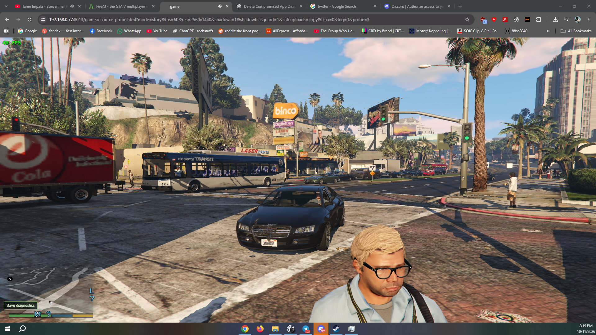
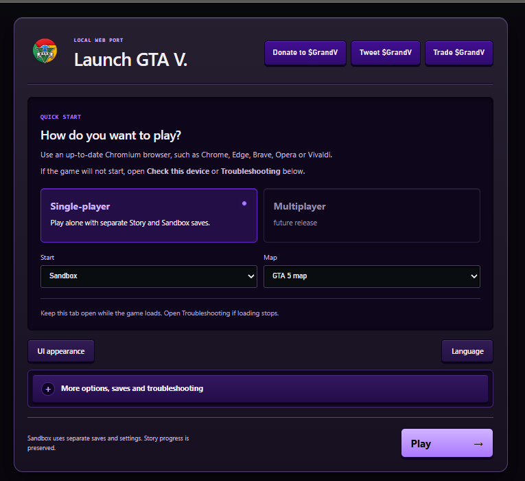
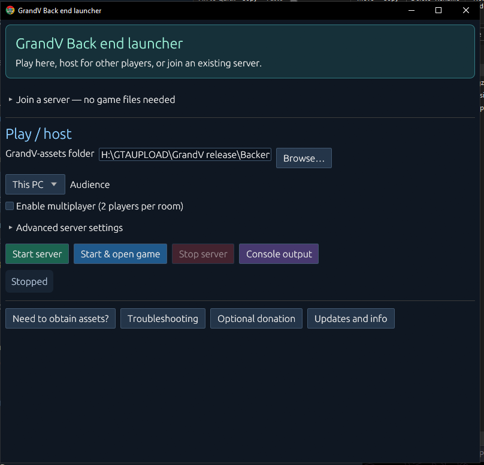

# Grand-V

Temporary public mirror of [Grand-V on GitHub](https://github.com/SebasKitten/Grand-V). This mirror contains the Rust launcher source and the same verified **2026.10.18** desktop builds. Game assets are separate.

**[Download the latest desktop builds](https://gitlab.com/SebasKitten/Grand-V/-/releases/launcher-2026.10.18)** · [Rust source and build instructions](LauncherApp/rust/README.md) · [Report an issue](https://gitlab.com/SebasKitten/Grand-V/-/issues)

| Platform | ZIP download |
| --- | --- |
| Windows x64 | [Windows ZIP](https://gitlab.com/api/v4/projects/87786272/packages/generic/grandv-launcher/2026.10.18/GrandV-2026.10.18-windows-x64.zip) |
| Linux x64 | [Linux ZIP](https://gitlab.com/api/v4/projects/87786272/packages/generic/grandv-launcher/2026.10.18/GrandV-2026.10.18-linux-x64.zip) |
| macOS Apple Silicon | [Apple Silicon ZIP](https://gitlab.com/api/v4/projects/87786272/packages/generic/grandv-launcher/2026.10.18/GrandV-2026.10.18-macos-apple-silicon.zip) |
| macOS Intel | [Intel ZIP](https://gitlab.com/api/v4/projects/87786272/packages/generic/grandv-launcher/2026.10.18/GrandV-2026.10.18-macos-intel.zip) |

[SHA-256 checksums](https://gitlab.com/api/v4/projects/87786272/packages/generic/grandv-launcher/2026.10.18/SHA256SUMS.txt). Extract the ZIP for your platform. The Windows executable is named `$GrandV back-end host.exe`; the Linux executable is `$GrandV back-end host`. The macOS ZIPs preserve the original app bundles and signatures.

Open **Need to obtain assets?** in the launcher for the asset setup instructions, wait for the download to finish, select the completed assets folder, then choose **Start & open game**. Keep the launcher running while playing or hosting. The macOS apps are locally signed but are not Developer ID signed or notarized. Full macOS/Linux gameplay validation remains pending.

Please report bugs with your device model, OS and browser versions, bug type, and steps to reproduce.

GTA V in the browser

Grand-V is a browser-based port of GTA V built on a reverse-engineered RAGE engine, converted to WebAssembly memory64 with shared-memory workers and WebGPU. The project builds on [rea](https://github.com/morluto/rea).

## Features

- Web launcher with Story and Sandbox modes
- Separate saves per mode
- Graphics settings and controller / touch controls
- Experimental multiplayer support
- Frame rate limits: 24, 30, and 60 FPS, with experimental 120 FPS

### Web UI

### Desktop backend launcher

## System Requirements

### Desktop (Primary Target)

| Component       | Minimum                          | Recommended                      |
|-----------------|----------------------------------|----------------------------------|
| CPU         | Modern 4-core processor          | —                                |
| RAM         | 8 GB (low-memory mode)           | 16 GB or more                    |
| Graphics    | WebGPU-compatible integrated or dedicated GPU with current drivers and browser hardware acceleration enabled | — |
| Browser     | Up-to-date Chrome, Edge, or compatible Chromium browser with shared WebAssembly memory64 support | — |
| OS          | Windows, macOS, or Linux         | Windows (most tested)            |

Compatibility on macOS and Linux depends on GPU, drivers, and browser support.

### Mobile

Android and iOS support is experimental. Browser feature availability, memory constraints, and mobile GPU compatibility remain limiting factors.

## Hosting & Setup

The project is designed to be as simple as possible to run.

- Local self-hosting — No certificate required.
- LAN or website hosting — The launcher manages server startup, graphics options, and LAN configuration.
- LAN HTTPS clients must install and trust the certificate generated by the launcher. This is not required when hosting as a standard HTTPS website.

Client devices only need to open the host’s URL in a compatible browser. No separate game installation is required on each client.

## Current Development Focus

Active work is ongoing in the following areas:

- Stability
- Rendering
- Audio
- Streaming
- Compatibility

## Disclaimer & Copyright

This project is provided for educational purposes only.  

We do not supply, distribute, or host any game data, mirror files, or proprietary assets belonging to Rockstar Games or Take-Two Interactive. Users are solely responsible for obtaining any required game files through legitimate means.

Grand Theft Auto V and all related trademarks, assets, and intellectual property are the property of their respective owners. This project is not affiliated with, endorsed by, or connected to Rockstar Games or Take-Two Interactive in any way.

## Support the Project

If you would like to support continued development, you can donate via the links below:

- SOL: **2QGxB8mYXUKunA338wZBfK4c1ZFiW7BMwkELMUScu8PB**
- BTC: **bc1qnqfnr93zvtujvvkmqpalvzqm64v32m38ug43sn**

Thank you for your support.

## Community

Created and maintained by SebasKitten.

Join the project channels to follow progress:

- Telegram: [https://t.me/reGRANDTA](https://t.me/reGRANDTA)
- Discord: [https://discord.gg/hrbcPjjZfj](https://discord.gg/hrbcPjjZfj)
- X: [@Sebas_Kitten](https://x.com/Sebas_Kitten)
